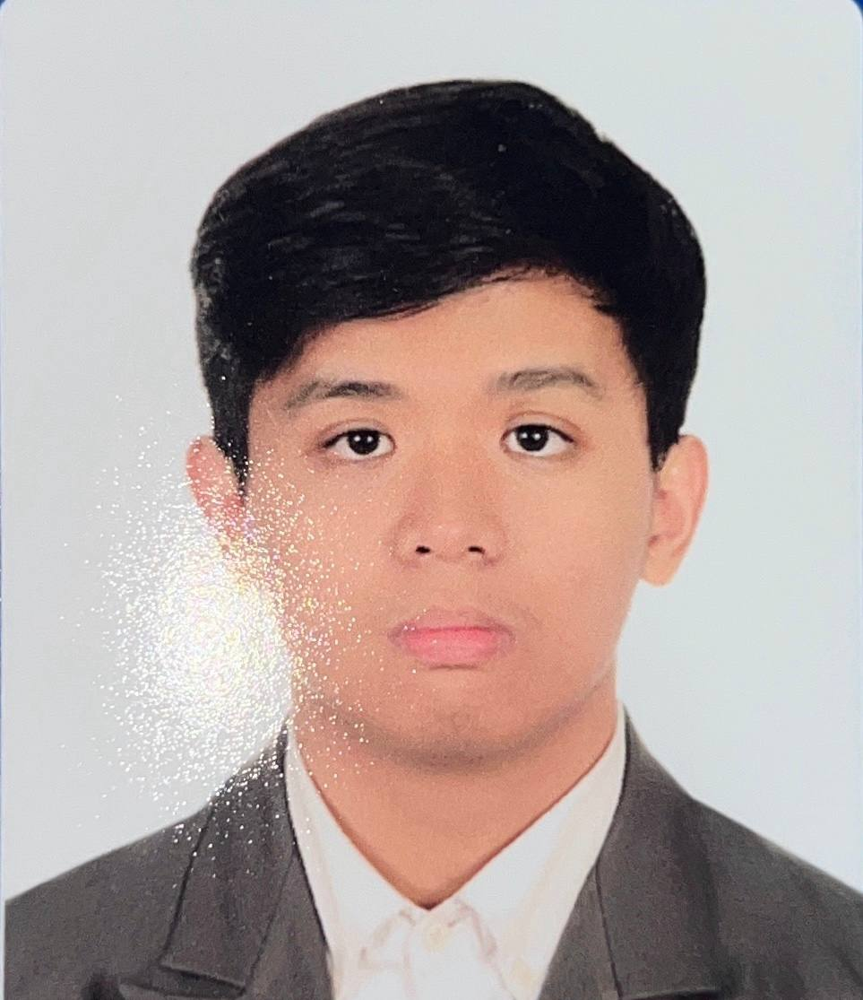

# Hi, I'm Russ Brian B. Vestil

## About Me
I am Russ Brian B. Vestil, with a flair for [your strengths]. I thrive on tackling complex problems and crafting elegant solutions. My journey in tech started when I took the [your program].

## Education
Bachelor of Science in Information Technology 
New Era University
2025 - Present

## Certifications
- Oracle Cloud Infrastructure 2023 AI Certified Foundations Associate

- Oracle Cloud Data Management 2023 Certified Foundations Associate

- Oracle Cloud Infrastructure 2023 Certified Foundations Associate

- SQL and Relational Databases 101

## Skill Sets
- Programming :  Java, Javascript
- Databases: IBM DB2 Cloud
- Tools:  Lucidchart, Jaspersoft Studio, Eclipse, HTML

## Contact Me
- LinkedIn: www.linkedin.com/in/russ-brian-vestil-a0b988449
- Email: russbrianv@gmail.com
